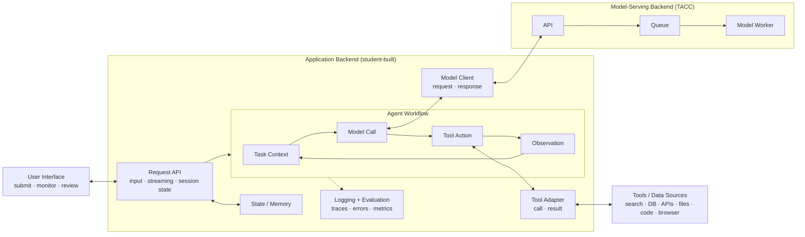

# CSIT6000V Course Project: Building an End-to-End Agent System

Course project for **CSIT6000V Advanced AI Computing and Systems** (HKUST CSE).
The goal is to build an end-to-end agent system on **TACC**. A user submits a task, an agent backend
works on it with a served model and external tools, and the user sees a verifiable result.

The full specification is in [`course_project.pdf`](course_project.pdf).

> **Status:** Team formation and topic selection. The proposal is due **October 29**.

---

## Team

Teams have 3–5 students.

| Name | GitHub | Role |
|------|--------|------|
| TBD  | TBD    | TBD  |

## Topic

**TBD.** The task needs a clear user need and a useful result. Suggested topics from the spec:

| Topic | Agent does | Output |
|-------|-----------|--------|
| Trip Planning Agent | Compares transport, stays, and activities, checks budget and time constraints, and revises the plan with the user | Day-by-day itinerary, itemized budget, source links, and alternative options |
| Literature Research Agent | Finds and reads papers, compares methods and evidence, and follows up on missing information | Cited literature review and a paper comparison table linked to supporting passages |
| Job Search and Application Assistant | Reads job postings, matches requirements to a résumé, and tailors materials using verified experience | Job shortlist with match reasons, application drafts, and a checklist of next steps |

Other ideas are welcome. The reference sample project is
[STORM](https://github.com/stanford-oval/storm), which researches a topic and writes a cited article.
The spec suggests two STORM extensions: improving question selection, and reducing latency and the number of model calls.

---

## Required System Architecture

**Required execution path:** Task → User Interface → Application Backend (agent workflow, model API, tools/data) → Visible Result (answer, artifact, or completed action).
Logs and traces feed into test cases and results.

### Components

- **User Interface**: task input, visible progress while the agent runs, and review of the final result.
- **Request API**: handles input, response streaming, and session state.
- **Agent Workflow**: the loop of task context → model call → tool action → observation.
- **State / Memory**: persists session and agent state across steps.
- **Model Client**: talks to the model-serving backend (endpoint → queue → model worker) on TACC.
- **Tool Adapter**: integrates **at least one** relevant capability, such as search, a database, external APIs, files, code execution, or a browser.
- **Logging + Evaluation**: records traces, errors, and metrics.

---

## Requirements

1. **Select a task or scenario.** Pick one concrete use case, such as coding, research, tutoring, or data analysis.
2. **Build the frontend.** Provide an interface for task input, visible progress, and review of the final result.
3. **Build the backend.** Implement the agent workflow, the model API, and tool/data integration.
4. **Evaluation.** Test representative cases, report metrics, and analyze **at least one failure**.
5. **Demo & Final Presentation.** Prepare a tested demo and present the task, system, evaluation, and limitations. Cover setup, configuration, and known limitations.

### Recommended Exploration Directions

| Direction | Goal | Metric |
|-----------|------|--------|
| **01 Task Learning & Adaptation** | Improve performance for a specific task, domain, or user group | Task-evaluation metric that quantifies improvement over a baseline |
| **02 System Efficiency** | Reduce latency or resource use without unacceptable loss of task quality | System metric that quantifies gains over a baseline without degrading task quality |

---

## Milestones

| # | Milestone | Due | Status |
|---|-----------|-----|--------|
| 1 | Team formation (3–5 students) | — | ⬜ |
| 2 | Topic selection + **two-page proposal** (motivation, proposed system, evaluation plan) | **Oct 29** | ⬜ |
| 3 | Project development: implement, evaluate, and refine scope based on feedback | — | ⬜ |
| 4 | Final presentation + short demo + final code repository | TBD | ⬜ |

## Final Deliverables

- [ ] Code repository (this repo)
- [ ] Final report
- [ ] Demo
- [ ] Final presentation

---

## Setup

TBD. This section will cover environment setup, configuration (model endpoint, API keys via `.env`, which is never committed), how to launch the model-serving backend on TACC, and how to run the frontend and backend locally.
