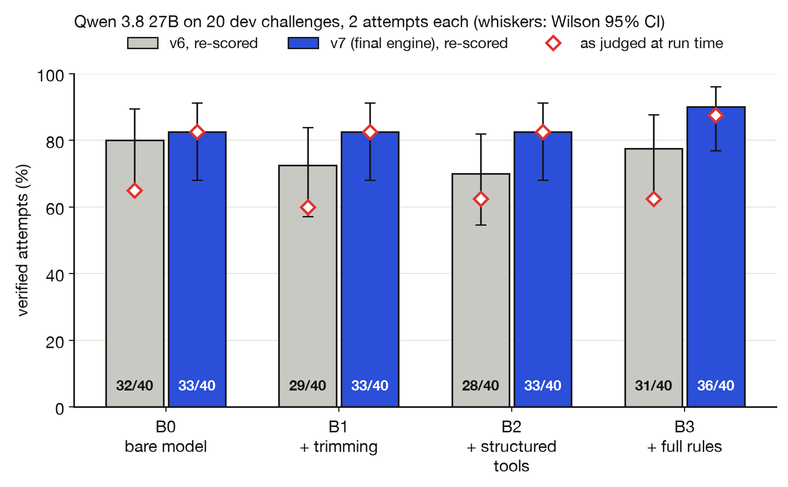
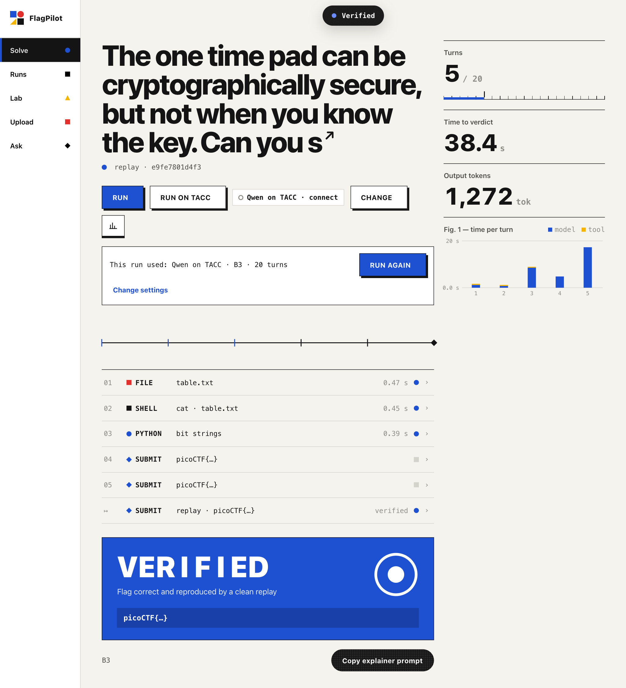
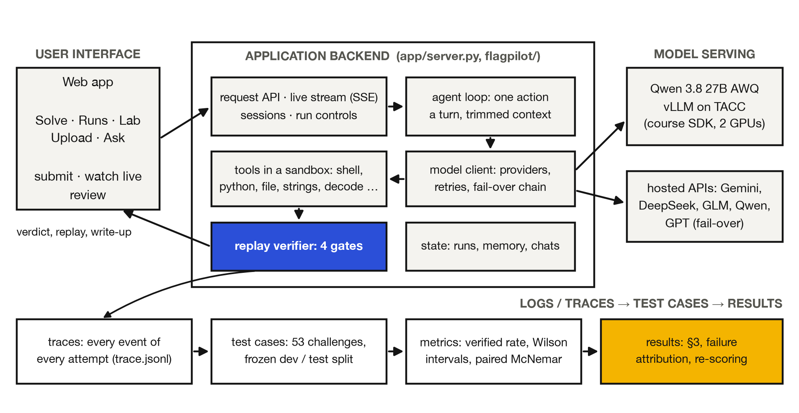
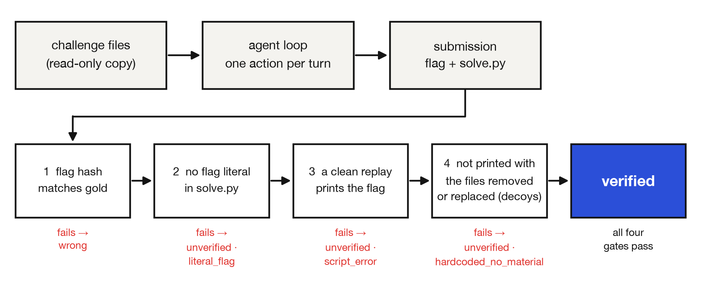
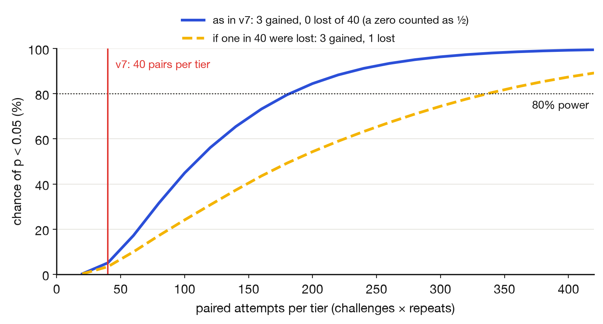
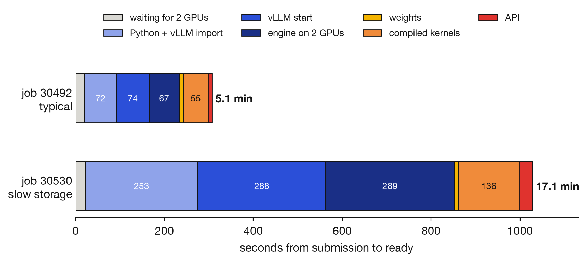

# FlagPilot: a replay-verified CTF agent

[](https://github.com/yyluck-luck/CSIT6000V-PJ/actions/workflows/tests.yml)


FlagPilot is an end-to-end agent system that solves offline CTF challenges and **proves** that it solved them. A
correct flag is not enough: the agent must also submit a standalone `solve.py`, and the verifier reruns it in a fresh
directory holding only the original challenge files. Only a flag that the script reproduces, and that disappears when
the files are taken away, counts as `verified`. The agent runs against a served model (vLLM on TACC, or any
OpenAI-compatible endpoint); a web app shows runs live, replays them, runs experiments, imports challenges and offers a
tutor; and every attempt is recorded as a replayable trace.



*Verified attempts of Qwen 3.8 27B on TACC, 20 dev challenges, two attempts each, per tier of the agent (B0 bare
model → B3 full agent). Bars: re-scored by today's verifier; diamonds: as judged at run time; whiskers: Wilson 95%
intervals. No difference between tiers is significant (§3).*

> **Safety.** FlagPilot runs shell commands written by a language model on the machine that hosts it. Without a
> container the sandbox is process-level, not a security boundary (Known limitations, item 1): use a machine or
> account you can spare, a VM, or the container image in `flagpilot/deploy/container`.

> **Assessment in one command:** `cd flagpilot && bash scripts/verify.sh` — 14 checks, no GPU, no network, no model
> weights. The last two drive the web app in headless Chrome (they need Node ≥ 22 and Chrome; skipped otherwise).

The README follows the NSDI '27 artifact guidelines: **Getting Started Instructions** (under 30 minutes), then
**Detailed Instructions**, which open with the [claims](#claims-and-how-to-check-them) this artifact supports and how to
check each one. Artifact for **CSIT6000V Advanced AI Computing and Systems**, HKUST CSE: the course specification is
[`course_project.pdf`](course_project.pdf) and the proposal this artifact implements is [`proposal.pdf`](proposal.pdf).
Group contributions are listed in the submitted PDF, not here.

**The course's requirements, and where this README covers them:**

| Requirement | What FlagPilot does | Where |
|---|---|---|
| 1. A task or scenario | Solve offline CTF challenges and prove each answer with a script that is replayed; a tutor for the same challenges | [Task set](#1-task-set) |
| 2. Frontend: task input, visible progress, review of the result | A web app: pick, upload or import a challenge; watch each step as it happens; verdict, replay and write-up | [The web app](#what-you-can-do-in-the-web-app) |
| 3. Backend: agent workflow, model API, tools and data | Agent loop, model client (vLLM on TACC, hosted APIs with fail-over), tools in a sandbox, replay verifier | [Architecture](#architecture), [Judging](#how-an-attempt-is-judged) |
| 4. Evaluation: representative cases, metrics, at least one failure analysed | 20 dev challenges × 4 tiers × 2 attempts on TACC; Wilson intervals and paired tests; replies that stop mid-JSON analysed | [§3](#3-reproducing-the-evaluation), claims C2–C4 |
| 5. Demo: setup, configuration, known limitations | One-command start; models, keys and TACC; known limitations | [Getting started](#getting-started-instructions), [§2](#2-model-backends), [§4](#4-deployment-on-tacc), [§7](#7-known-limitations-and-expected-variation) |

| Getting started | Detailed instructions |
|---|---|
| [One command](#fastest-path-one-command) · [The web app](#what-you-can-do-in-the-web-app) · [Step by step, offline](#step-by-step-path-no-model-no-network) | [Claims](#claims-and-how-to-check-them) · [Architecture](#architecture) · [Judging](#how-an-attempt-is-judged) · [Tasks](#1-task-set) · [Models](#2-model-backends) · [Evaluation](#3-reproducing-the-evaluation) · [TACC](#4-deployment-on-tacc) · [Keys](#keys) · [Metrics](#5-metrics) · [Tests](#6-tests) · [Limitations](#7-known-limitations-and-expected-variation) · [Troubleshooting](#8-troubleshooting) |

---

## Getting Started Instructions

Two paths, either well under 30 minutes. The **fastest path** starts the web app with the real models in one command.
The **step-by-step path** (Steps 1–5) runs the pipeline on three bundled challenges with no model, no network and no
keys, and shows the expected output of each step.

### Fastest path: one command

```bash
git clone https://github.com/yyluck-luck/CSIT6000V-PJ.git
cd CSIT6000V-PJ
./start.sh
```

The browser opens at <http://127.0.0.1:8080> with the real agent ready. It needs **Python 3.11 or newer and git,
nothing else**: no packages, no GPU, no setup. On the first run `./start.sh` fetches the 53 evaluation challenges once
(InterCode-CTF, about 100 MB, half a minute; see [Task set](#1-task-set)); offline it starts with the three bundled
demo challenges instead.

**Keys are included.** The repository is public, and [`shared.env`](shared.env) carries working keys (Gemini, and an
OpenAI-compatible relay that serves DeepSeek, GLM, Qwen and GPT models), so a fresh clone runs the real models at once.
To use your own, copy [`env.example`](env.example) to `.env` (never committed; it takes precedence). `./start.sh
--model mock` runs with no keys at all. Read [Keys](#keys) for what that means in a public repository.

| Command | What it does |
|---|---|
| `./start.sh` | Start on port 8080 and open the browser (if it is already running, just open it) |
| `./start.sh --port 9000` | Use another port |
| `./start.sh --model mock` | Offline demo model; also `provider:deepseek`, `provider:glm`, `provider:qwen`, `provider:gpt`, or an exact model name |
| `./start.sh --check` | Check that every model provider answers with this copy's keys (one tiny request each); starts no server |
| `./start.sh --restart` | Restart, for example after `git pull` |
| `./start.sh --stop` | Stop the FlagPilot started from this folder (a port held by another copy is reported, not taken over) |

The default model is `auto`: Gemini when a Gemini key is present, otherwise the first provider with a working key,
otherwise the offline demo model. The server log is `flagpilot/.run/web-8080.log`. Expected output:

```text
First run: fetching the evaluation challenges (InterCode-CTF, about 100 MB, only this once)...
Evaluation challenges ready: 53 in flagpilot/tasks.
FlagPilot is running: http://127.0.0.1:8080
  model: provider:gemini   log: flagpilot/.run/web-8080.log   stop: ./start.sh --stop

$ ./start.sh --check
  OK    Gemini    answered by gemini-flash-lite-latest in 2.1 s
  OK    DeepSeek  answered by deepseek-v4.1-flash in 10.7 s
  OK    GLM       answered by glm-5.3-flash in 2.5 s
  OK    Qwen      answered by qwen3.8-flash in 2.4 s
  OK    GPT       answered by gpt-6.2-astra in 2.6 s
  when a provider fails, answers fall back to: deepseek-v4.1-flash
  Qwen on TACC: needs no key; needs your own TACC account and the course SDK (tcloud at /path/to/tcloud)
```

A quick end-to-end check: on **Solve**, pick `crypto-005` and press **Run**. With Gemini it ends `VERIFIED` in about 3
turns and 15 seconds; on **Ask**, any question gets an answer in a few seconds. Qwen on TACC needs no API key, only
your own TACC account with the course SDK (§4) — the page asks for the SDK's path the first time and remembers it;
nothing here can submit jobs on someone else's account.

### What you can do in the web app

| Page | What you can do |
|---|---|
| **Solve** | Pick a challenge (`/` or ⌘K to search) and set the run in the bar above it: model, tier (B0–B3) and turns (20, 40, 60 or 100). Press **Run** and watch every step: *Step mode* holds each command until you approve, edit or skip it, a hint reaches the agent mid-run, **+20 turns** gives a running local attempt more room, and **Finish** ends it at once. The verdict says whether the flag was **proved** and, if not, why. A finished run, or any replay, shows the settings it used and can **Run again** with them. **Run on TACC** sends the same run to Qwen 27B on the course cluster; the Qwen chip shows the session starting step by step. |
| **Runs** | Every past attempt, replayable step by step. |
| **Lab** | Experiments on the agent with 95% intervals and paired tests: *Compare* tiers and models on one challenge, *Batch* over many, *Diff* two runs, and a memorization *Probe*. |
| **Upload** | Upload your own challenge, or find one in a public archive of past CTFs and import it by search or link (a link that is a little wrong is corrected). An import can be previewed, customised and drafted by the AI, which never sees the answer. A challenge that needs its original network service is marked, and asks before its first run. |
| **Ask** | A tutor that can run commands in the challenge's sandbox; every flag it states is checked. A new conversation is about Solve's challenge, and choosing another in Ask never changes Solve's. Messages queue while a reply comes in and can be recalled; a conversation can be left while it is answered (its row in **Threads** blinks, even before its first message has gone out). A bar above the box shows what the model sees: leave an exchange out, put it back, or start fresh from a message; past 60% of the model's window the oldest exchanges are compressed into a summary. Ask answers with the hosted models; Qwen on TACC runs challenges from Solve. |



*Solve replaying one of `v7`'s verified attempts (`crypto-074`, Qwen 3.8 27B on TACC, tier B3): the settings the run used,
its five steps, the replay of its script and the verdict. The flag is hidden in this picture.*

### Step-by-step path (no model, no network)

Five steps from a terminal, each with its expected output: check the environment, solve the three bundled challenges
with a scripted model, show that a wrong answer is rejected, open the web app, and replay finished runs.

#### Prerequisites

| Requirement | Notes |
|---|---|
| Python 3.11 or newer | **No third-party packages are required** for the core runtime |
| A model endpoint | Optional for the quickstart: `--model mock` runs the full pipeline with no model |
| Optional: `flagpilot/requirements.txt` | Only unlocks the `smt` action, encrypted storage, and two crypto libraries |

Verified on Python 3.11–3.13 on macOS 14 (arm64) and on Linux (TACC compute node, Python 3.11). Every optional
dependency degrades to an explicit "not available" message rather than a crash; `doctor` reports which are active.

#### Setup

```bash
git clone https://github.com/yyluck-luck/CSIT6000V-PJ.git flagpilot-artifact
cd flagpilot-artifact/flagpilot
export FLAGPILOT_TASKS="$PWD/demo-tasks"
export FLAGPILOT_RUNS="$PWD/runs"        # optional; defaults to ./runs
```

`FLAGPILOT_TASKS` points at a task-set root; the bundled `demo-tasks/` is a complete, valid task set.

#### Step 1 — check the environment

```bash
python3 -m flagpilot doctor
```

Expected output (the CLI is localized in Chinese; field meanings are annotated):

```text
FlagPilot 0.1.0
python           3.13.12  (.../bin/python3)
题库             .../flagpilot/demo-tasks      # task-set root
运行产物         .../flagpilot/runs            # output root

题目数           3  Demo=3                     # 3 tasks loaded
题库一致性       通过（3 题的目录与附件齐全）  # index and files agree
泄漏检查         通过（无明文 gold、无题解目录） # no plaintext gold leaked

网络隔离         proxy-only  ← 不可作为强隔离证据
资源上限         可用
隔离等级         process  ← 非容器，报告里必须如实说明
容器             none
SMT (z3)         可用
反汇编           /usr/bin/objdump
调试器           未找到  ← 只能靠 shell 调其它调试器
```

The `隔离等级` (isolation level) and `容器` (container) lines state what isolation was actually achieved, so that a
report never claims more: without a container runtime and image it says `process`.

#### Step 2 — run the bundled demo end to end

```bash
python3 -m flagpilot batch --batch demo --model mock --limit 3 --workers 1
```

Three attempts, each with a fresh sandbox, a scripted policy, a replay and a write-up. Expected output (timings vary
by a few hundredths of a second; verdicts and counts do not):

```text
[batch] demo: 3 题 × 1 seeds, model=mock, ablation=custom（截断 + 结构化工具 + 完整 prompt）
[1/3] demo-001-s0            VERIFIED   turns=3 0.21s
[2/3] demo-002-s0            VERIFIED   turns=3 0.17s
[3/3] demo-003-s0            VERIFIED   turns=3 0.16s

attempts        3   ablation=custom
verified        3  (100.0%, 95% CI 43.9%–100.0%)
raw (flag ok)   3  (100.0%, 95% CI 43.9%–100.0%)
wrong / budget / error  0 / 0 / 0
```

Each attempt lands in `runs/demo/<task>-s0/`: `trace.jsonl` (every event), `replay/` (the clean room of the rerun),
the directories of gate 4's checks, and `writeup.md`.

#### Step 3 — verify that the verdict is not a rubber stamp

A verifier that always says `verified` proves nothing. Corrupt every gold hash and the same run is rejected:

```bash
cp -r demo-tasks /tmp/neg-tasks
sed -i.bak 's/"gold_sha256": "[a-f0-9]*"/"gold_sha256": "0000000000000000000000000000000000000000000000000000000000000000"/' \
  /tmp/neg-tasks/index/tasks.jsonl
FLAGPILOT_TASKS=/tmp/neg-tasks python3 -m flagpilot run --task demo-001 --model mock --batch neg
```

Expected (excerpt of the summary): `"verdict": "wrong"`, `"reason": "wrong_flag"`. The model produced the same flag
and the same script; only the gold hash changed, and the verdict flipped.

#### Step 4 — open the web interface

```bash
./start.sh --model mock          # from the repository root; or: python3 -m flagpilot web --model mock
```

Open <http://127.0.0.1:8080>, pick a challenge and press **Run**: the middle column streams the agent's turns (thought,
action, real tool output), the right column shows the verdict, the replay and the budget counters, and a `writeup.md`
download appears at the end. The pages are described in [the table above](#what-you-can-do-in-the-web-app), with a
screenshot.

#### Step 5 — replay a finished run without a model

```bash
python3 -m flagpilot web --replay ./runs/demo --port 8080
python3 -m flagpilot show --run-dir ./runs/demo/demo-001-s0 --full     # or as a timeline in the terminal
```

```text
FlagPilot demo → http://127.0.0.1:8080   model=mock
回放模式：挂载 3 个已完成的 run（只读，不需要模型）
  demo-001-s0   http://127.0.0.1:8080/?run=c6a6f48eaf3e   verified/match
  demo-002-s0   http://127.0.0.1:8080/?run=597af7758ad6   verified/match
  demo-003-s0   http://127.0.0.1:8080/?run=b4b8b8900546   verified/match
```

Run ids hash the run directory, so they differ between machines. A replay and a live run are the same data structure
on the server, so the page looks the same; only finished runs are mounted.

| Step | Command | Expected |
|---|---|---|
| 1 | `doctor` | 3 tasks loaded, index and leak checks pass |
| 2 | `batch --model mock --limit 3` | 3/3 `verified`, under a second |
| 3 | `run` with a corrupted gold | `wrong` / `wrong_flag` |
| 4 | `web --model mock` | the page loads on port 8080; a run reaches `verified` |
| 5 | `web --replay ./runs/demo` | 3 runs mounted, each opening at `verified/match` |

Total time on a laptop: under a minute. No GPU, no API key, no network.

---

## Detailed Instructions

> Commands run from the `flagpilot/` directory created in [Setup](#setup), unless a step says otherwise.

### Claims and how to check them

| # | Claim | Where | How to check |
|---|---|---|---|
| C1 | A flag counts only when a standalone script reproduces it in a clean sandbox and the answer depends on the challenge's material; typed-in, encoded and material-free answers are rejected | [Judging](#how-an-attempt-is-judged) | Getting Started Step 3; `bash scripts/verify.sh` (check "判据负向"); `tests/test_verify.py` |
| C2 | On the 20-challenge dev split, Qwen 3.8 27B verifies 33 of 40 attempts as the bare model (B0) and 36 of 40 as the full agent (B3), re-scored (as run: 33 and 35); B1 and B2 verify 33 each. No step of the ladder is significant (B0 to B3: exact McNemar p = 0.25); showing a gain of this size with 80% power would take about 190 paired attempts per tier | [§3](#3-reproducing-the-evaluation) | Offline from the records in `flagpilot/results/tacc/v7`; rerun on TACC with `deploy/tcloud/pipeline.sh` |
| C3 | The verifier's rejections are checked, not assumed: replaying every recorded submission through today's verifier found 20 correct solutions rejected in `v6` and one in `v7`; re-scored, B3 goes from 31 (`v6`) to 36 (`v7`). The third stage of gate 4 changes none of the 320 verdicts | §3; [evaluation notes](flagpilot/docs/EVALUATION_NOTES.md) | `python3 scripts/rescore.py results/tacc/v6` and `results/tacc/v7` |
| C4 | Failures are attributed from the traces: every one of `v7`'s 51 protocol breaks is a reply the model ended on its own, 48 of them inside their JSON, and 47 came after one of its own replies had been shown to it cut short (`v6`: 85, 81, 81) | §3; Known limitations, item 14 | `python3 scripts/protocol_breaks.py results/tacc/v7` |
| C5 | The system works end to end: web app, live runs, replays, Lab statistics, hosted models with fail-over, and Qwen on TACC through the course SDK | Getting Started; §4 | `./start.sh`, `./start.sh --check`, `bash scripts/verify.sh` (14 checks, including 105 browser checks and 91 controls); on the cluster, `scripts/live_tacc_check.py` (17 checks) |

**Not claimed.** An order of the four tiers: no step from B0 to B3 is significant in `v6` or `v7`, so the ladder shows
what each tier adds, not that it helps. The E3 efficiency grid and the E4 escalation study are implemented and tested
but were not run at scale. The three remedies for replies that stop mid-JSON and the sampling seed are implemented and
tested but not yet measured on the cluster, and the container image is defined but was not built on our machines. The
single DeepSeek baseline in `docs/EVALUATION_BASELINE.md` is reported as measured, not as a matched comparison.

### Contents of this artifact

| Path | Contents |
|---|---|
| `proposal.pdf`, `course_project.pdf` | The proposal this artifact implements (goals, experiments E1–E4, cut order) and the course specification |
| `start.sh`, `shared.env`, `env.example` | One-command start / restart / stop; the shared keys (committed on purpose); a names-only template for `.env` |
| `flagpilot/flagpilot/` | Core package: agent loop, tools, sandbox, replay verifier, metrics, storage |
| `flagpilot/app/` | Web app (zero-dependency HTTP server and single-page frontend) |
| `flagpilot/demo-tasks/` | **Three synthetic tasks bundled so the quickstart runs offline** (trivial on purpose: they exercise the pipeline, not the model) |
| `flagpilot/tests/` | Unit and integration tests (§6) |
| `flagpilot/results/` | The evaluation's records (every attempt's trace, script and write-up; each batch's ledger, summary, job logs and re-score), and the logs of the live checks on TACC |
| `flagpilot/scripts/` | Self-check, browser tests, live TACC check, re-scoring, protocol-break counts, figures, secret scan, split and task-set builders |
| `flagpilot/deploy/` | TACC jobs through the course SDK (`tcloud/`: serving, client, clean-up, pipeline), the sandbox container image (`container/`), Slurm templates |
| `flagpilot/docs/` | Design, dataset contract, TACC deployment and [reliability notes](flagpilot/docs/TACC_RELIABILITY.md), [evaluation notes](flagpilot/docs/EVALUATION_NOTES.md), screenshots |
| `docs/figures/`, `docs/submission/` | The README's figures (charts and diagrams from `flagpilot/scripts/make_figures.py`, one screenshot) and the build of the submission PDF |
| `.github/workflows/` | CI: the unit tests on Python 3.11–3.13 and syntax checks, on every push |

### Architecture



The figure follows the course's required execution path. The **web app** (`flagpilot/app/index.html`, one page, no build
step) submits a challenge and follows the run over a live event stream. The **application backend** (`app/server.py`, a
standard-library HTTP server) runs the **agent loop** (`flagpilot/agent.py`): each turn the model picks one action, a
**tool** runs it in the challenge's **sandbox** (`flagpilot/sandbox.py`, `flagpilot/tools.py`), and the trimmed output
goes back into the context. The **model client** (`flagpilot/client.py`) talks to Qwen 3.8 27B served by vLLM on TACC
(through the course SDK) or to hosted APIs, retrying and handing a turn to the next provider when one fails. A submission
goes to the **replay verifier** (`flagpilot/verify.py`); its verdict, the replay and a write-up return to the page. Every
event of every attempt is written to its `trace.jsonl`; batches of attempts on the frozen task split become the metrics
and results of §3.

### How an attempt is judged



| Verdict | Meaning |
|---|---|
| `verified` | The flag matches gold **and** the script reproduces it from scratch, from the material |
| `reproduced` | The script reproduces the flag, but the task has no gold hash to compare against |
| `unverified` | The flag matches gold, but the script is missing, fails, contains the flag, or works without the material |
| `wrong` | The flag does not match gold |
| `budget` | Turn, token, wall-clock or format budget exhausted |

**Gate 4, the material-dependence check, runs in three stages.** The verifier reruns the script (1) with
`challenge/` empty, (2) with every file replaced by filler of the same length, and (3) with every file replaced by a
*shaped* decoy: the same name, length and first bytes (the file's magic number), letters still letters, digits still
digits, symbols moved among the file's own symbols, binary content XORed. If the submitted flag comes out in any
stage, the answer did not come from the material: `unverified / hardcoded_no_material`. Stage 2 catches a decorative
`open('./challenge/x')` whose result is never used; stage 3 catches a script that checks the file's format and then
prints a hard-coded answer, or falls back to one when the real file cannot be read as text (on stage 2's filler such
a check fails, so the script printed nothing there and used to pass). Correct solutions (base64, Morse, a Caesar key search over the file) still pass, and a decoy
is fixed by task and file, so a submission always gets the same verdict. Tasks without attached files skip gate 4.

**Material in the challenge text.** Some challenges put their input in the statement (the ROT13 challenge's
ciphertext, a base64 string, "convert 42 to binary"), so a correct script has to copy it and still prints the flag
without the files. The verifier then changes every literal the script copied from the statement (letters and digits
shifted by one to three places, numbers plus one) and reruns it under the same conditions: if the flag no longer comes
out, the answer is computed from the statement and the attempt is `verified`. Fragments of the flag itself (such as
`picoCTF{`) and literals shorter than 8 characters never count as material.

**Self-check and budgets.** Before submitting, the agent may spend a turn on `run_script`, which runs its script under
exactly the replay conditions. An attempt may submit twice, on two independent budgets: one correction of a wrong flag
and one repair of a script that does not replay; the summary keeps `first_submit_verdict` apart from the final one, so
repairs are not counted as model capability. The evaluation's budget is 20 turns, 32,000 output tokens or 25 minutes,
whichever comes first; on the 20 dev challenges it did not bind (verified `v7` attempts took a median of 4–5 turns, at
most 14). On Solve the turns are chosen before a run (40 by default; 20, 60 or 100), output tokens and time grow with
them (1,600 tokens and 75 s a turn), and a running local attempt can be given 20 more at a time, up to 200.

### 1. Task set

A task-set root holds `index/tasks.jsonl` (fields `task_id`, `name`, `category`, `title`, `query`, `gold_sha256`,
`assets`, `assets_dir`, `suggested_tools`, `scope`) and one directory of files per task, copied read-only into the
sandbox as `./challenge/`. The task set stores only `gold_sha256`, and plaintext flags never enter the sandbox (contract:
`flagpilot/docs/TASKS.md`). The committed run records do contain the flags the model submitted: they are the evidence of
each verdict.

**The evaluation task set is not redistributed.** It is derived from picoCTF through InterCode-CTF (General Skills 25,
Cryptography 16, Forensics 12; network-dependent tasks removed): **53 tasks**, 43 `core` and 10 `extra-gs`, with a
frozen dev / test split (`docs/splits-picoctf-53.json`). There are no reverse-engineering tasks (Known limitations,
item 5). `./start.sh` fetches it, pinned to InterCode-CTF commit `c3e46d8`: rebuilding from that commit reproduces
`index/tasks.jsonl` byte for byte, so the recorded results and the frozen split stay valid even if upstream moves
(`FLAGPILOT_INTERCODE_REF=<commit>` builds a different set deliberately). To rebuild it by hand:

```bash
python3 scripts/build_taskset.py --src /path/to/intercode/data/ctf --out ./ctf-tasks
export FLAGPILOT_TASKS="$PWD/ctf-tasks"
python3 -m flagpilot list                     # 43 core tasks (--scope extra-gs: the other 10)
```

**NYU CTF Bench** (cryptography and reverse engineering) is loaded at run time and filtered to offline-solvable tasks:
`python3 -m flagpilot dataset --name nyu --split dev` (16 tasks; `test`: 46). Upstream is cloned into
`~/.cache/flagpilot/nyu-ctf-bench` and never committed (`flagpilot/docs/DATASET.md`). Tasks can also be uploaded or
imported in the web app.

### 2. Model backends

| Backend | Flag | Needs | Use |
|---|---|---|---|
| Scripted policy | `--model mock` | Nothing | Pipeline checks, offline demo, CI |
| OpenAI-compatible endpoint | `--model <name> --base-url <url>` | A served model (vLLM, Ollama, a hosted API) | Real evaluation |
| DeepSeek hosted API | `--track H` | `DSV41_API_KEY` in `.env` | Evaluation without a GPU, priced per request |

The scripted `mock` policy is **not a model**: it lists the challenge, prints every file and submits the first
flag-shaped string with a `grep`-style script. Its accuracy must never be reported as a model result. A local model:

```bash
ollama serve & ollama pull qwen3:8b
python3 -m flagpilot batch --batch local --model qwen3:8b --base-url http://127.0.0.1:11434/v1 --limit 20 --workers 1
```

`--track H` fills in the endpoint and the price table, and prices cache hits, cache misses and output separately.
Replies follow a JSON protocol. The same action written as a model's own tool-call markup (DeepSeek's DSML), as
function-call JSON, with raw tabs or newlines inside a string, or after a stray `</think>` is read as that action: runs of
imported challenges on 2026-11-22 lost turns, and two runs ended, on such replies from DeepSeek (the fail-over target) and
GLM. None of `v7`'s 51 protocol breaks is of these kinds; 2 of `v6`'s 85 are. The page reads a reply by the same rules
and, since 2026-11-22, shows the action the engine itself parsed (an `action` event in the trace); before, it knew none of
these shapes and showed such steps as "? —". `tests/test_page_parser.py` runs the page's parser under node on every reply
in `flagpilot/results/` and fails where it disagrees with the engine.
An action that gave exactly the same result on the two turns before is not run a third time: the model is told why, and
the third such reply in a row ends the attempt (`repeat_loop`). The earlier guard warned once per action and never
again; on 2026-11-22 Qwen on TACC then sent one reply 83 times and used all 100 turns on it. The evaluated batches ran
with the earlier guard.
`--sample-seed N` sends seed N+s with every request of attempt s (vLLM and OpenAI honour it; a server that rejects the
field stops getting it); the evaluated batches did not send one.

### 3. Reproducing the evaluation

The results are batches of the TACC pipeline (Qwen 3.8 27B AWQ served by the course's vLLM job) on the 20 core
challenges of the frozen dev split:

| Batch | What | Claims |
|---|---|---|
| `v7` | All four tiers B0–B3, two attempts per challenge (n = 40 per tier), the final engine: B0 and B3 at commit `103411e`, B1 and B2 the same day at `e8b82d4` (the same engine with today's verifier) | C2–C4 |
| `v6` | All four tiers, two attempts each, before the fixes; as run and re-scored | C3, C4 |
| `v5` | B0 and B3, one attempt each; a sanity check against Gemini | — |

The records of all three are in `flagpilot/results/tacc/` (every attempt's trace, script and write-up, each batch's
`runs.jsonl` ledger, summary and job logs). Design rationale: `flagpilot/docs/DESIGN.md`. A separate DeepSeek Flash
B3 baseline on all 53 tasks is in `flagpilot/docs/EVALUATION_BASELINE.md`.

**Check the numbers offline** (no model, no cluster):

```bash
export FLAGPILOT_RUNS="$PWD/results"
python3 -m flagpilot compare --batches tacc/v7/tacc-dev-v7-B0,tacc/v7/tacc-dev-v7-B1,tacc/v7/tacc-dev-v7-B2,tacc/v7/tacc-dev-v7-B3
python3 -m flagpilot pair --a tacc/v7/tacc-dev-v7-B0 --b tacc/v7/tacc-dev-v7-B3   # exact McNemar on matched attempts
python3 -m flagpilot report --batch tacc/v7/tacc-dev-v7-B0                         # failure attribution
python3 scripts/protocol_breaks.py results/tacc/v7                                 # C4
```

**Re-score with today's verifier** (C3). `scripts/rescore.py` replays each attempt's submissions in the order the agent
made them, each with the script recorded in its trace: the first one today's verifier accepts is where the attempt
would have ended. The replays need the task set (§1) and a `python3` on `PATH` with pycryptodome and gmpy2, as the TACC
jobs had (the script stops otherwise); on macOS, GNU-like `zcat` and `strings` are put first on the replays' `PATH`, so
a Mac gives the cluster's verdicts:

```bash
python3 -m venv .venv && .venv/bin/pip install -q -r requirements.txt pycryptodome gmpy2
PATH="$PWD/.venv/bin:$PATH" python3 scripts/rescore.py results/tacc/v7 --csv /tmp/v7.csv
PATH="$PWD/.venv/bin:$PATH" python3 scripts/rescore.py results/tacc/v6 --csv /tmp/v6.csv
```

The same records open in the web app: **Runs** replays any attempt and **Lab → Results** shows the forest plot, the
challenge × tier map and the paired tests (`./start.sh` copies the records into `runs/tacc` on a fresh clone).

#### Results

**`v7`, the final engine** (2026-11-21; the figure at the top):

| Tier | Verified as run | 95% interval | Re-scored | Mean turns | Mean tokens | Median wall time |
|---|---|---|---|---|---|---|
| B0 bare model | 33/40 · 82.5% | 68.0–91.2% | 33/40 | 5.5 | 16,148 | 29 s |
| B1 + trimming | 33/40 · 82.5% | 68.0–91.2% | 33/40 | 5.8 | 20,375 | 31 s |
| B2 + structured tools | 33/40 · 82.5% | 68.0–91.2% | 33/40 | 6.1 | 18,739 | 31 s |
| B3 + full rules | 35/40 · 87.5% | 73.9–94.5% | 36/40 | 5.9 | 20,947 | 34 s |

Re-scored, each step up the ladder is within chance: B0 to B1 2 attempts gained and 2 lost (exact McNemar p = 1.0), B1
to B2 3 and 3 (p = 1.0), B2 to B3 4 and 1 (p = 0.38), B0 to B3 3 and 0 (p = 0.25; as run 3 and 1, p = 0.63).

**`v6` and what changed.** `v6` verified 26, 24, 25 and 25 of 40 as run, and 32, 29, 28 and 31 re-scored. Two things
separate it from `v7`. First, the verifier: all 17 attempts it ended as `hardcoded_no_material` were correct (their
scripts decode data written in the statement, which the verifier now recognises), and so were three more; replaying
every submission in order through today's verifier finds these 20. Second, a bug: the prompt carried the statement's
first 90 characters (its display title), so for 22 of the 53 challenges the data in the rest of the statement never
reached the model; 9 of the 20 dev challenges were affected. Fixed in `v7`, which also cuts off replies stuck repeating
themselves. Against `v6`, re-scored, B3 rose from 31 to 36 of 40 (5 gained, none lost, p = 0.06), all on challenges
whose statement `v6` had cut, and mean tokens per attempt fell by about 40%. Details, per attempt: [evaluation
notes](flagpilot/docs/EVALUATION_NOTES.md).

**Statistical power.** Forty paired attempts cannot resolve a difference of this size. Taking `v7`'s B0 against B3
(3 attempts gained, none lost; the zero counted as half) as the true effect, the exact McNemar test at α = 0.05 has a
5% chance of significance at n = 40, and reaches 80% at about 190 paired attempts per tier; if one attempt in 40 went
the other way, at about 340. Attempts on the same challenge are correlated, so more challenges help more than more
repeats.



*Power of the exact McNemar test for B0 against B3, for an effect the size of `v7`'s (blue) and with one loss in 40
added (yellow). `v7` ran 40 pairs per tier (red).*

**Replies that stop mid-JSON** (C4). Every one of `v7`'s 51 protocol breaks (18, 14, 11 and 8 at B0–B3) is a reply the
model ended on its own (`finish_reason` is `stop`, not the token limit); 48 stop inside their JSON, most in
`crypto-079` (copying an RSA modulus), `crypto-092`, `crypto-093` and `forensics-059`. The history keeps the first
2,000 characters of each of the model's replies, so a long reply stays in the conversation as a JSON object cut off
mid-string, and 47 of the 51 breaks came after such a reply in the same attempt, one the agent had parsed and run.
This is an association in the records, not a controlled result. Three switches, all off by default so that the
default engine is still `v7`'s: `--reply-history elide` keeps long replies whole in the history (shortened in the
middle of their longest field), `--continue-cut` asks the model once to finish a reply that stopped mid-JSON, and
`--fence-output` ends every tool output with `--- end of output ---` (on TACC: `FP_REPLY_HISTORY=elide`,
`FP_CONTINUE_CUT=1`, `FP_FENCE_OUTPUT=1`). They are tested offline; the batch that would measure them is in the
[evaluation notes](flagpilot/docs/EVALUATION_NOTES.md#replies-that-broke-the-json-protocol-claim-c4).

#### Rerunning on TACC

Needs your own TACC account and the course SDK `tcloud`. One serving job lasts at most an hour, so the four tiers run
as two pipelines:

```bash
FP_BATCH=tacc-dev-v7 FP_SPLIT=dev FP_LIMIT=0 FP_SEEDS=2 FP_WORKERS=4 FP_ABLATIONS=B0,B3 deploy/tcloud/pipeline.sh runs/tacc/v7
FP_BATCH=tacc-dev-v7 FP_SPLIT=dev FP_LIMIT=0 FP_SEEDS=2 FP_WORKERS=4 FP_ABLATIONS=B1,B2 deploy/tcloud/pipeline.sh runs/tacc/v7
```

Each pipeline starts the serving job (5–6 minutes to ready once two GPUs are free, up to 17 on slow storage), runs the
batch, keeps only each attempt's records on the cluster, downloads them and cancels the serving job. If a batch stops
with `No space left on device`, free space first with `FP_DROP="<batches>" deploy/tcloud/submit.sh cleanup`.
Expected variation: without `FP_SAMPLE_SEED` a rerun samples different attempts; with 40 attempts per tier the Wilson
interval is about ±15 points. Queueing changes wall-clock times, not verdicts.

#### Experiments E1–E4

| Experiment | Command | Status |
|---|---|---|
| **E1** ablation ladder: B0 bare loop, B1 + context trimming, B2 + structured tools, B3 + full prompt (one change per rung) | `for b in B0 B1 B2 B3; do python3 -m flagpilot batch --batch e1-$b --ablate $b --model <m> --base-url <url> --limit 20 --workers 1; done` then `compare --batches e1-B0,…` and `pair --a e1-B2 --b e1-B3` | Run on TACC as `v6` and `v7` (C2) |
| **E2** verification and attribution: memory probe without tools or files at three disclosure levels; raw − verified gap; failure attribution | `python3 -m flagpilot probe --batch e2-probe --mode brief --limit 20`, `report --batch e2-probe` | Gap and attribution reported (C3, C4); probe not run at scale |
| **E3** efficiency grid: observation policy × turn budget × concurrency, prefix caching on and off | `sbatch --export=ALL,FP_E3=1,FP_PREFIX_CACHE=1,FP_MAX_SEQS=4,FP_LIMIT=20,FP_SPLIT=dev deploy/run.slurm`, `compare --e3 --ref …` | Implemented and tested; not run (the course fixes `max_num_seqs` and prefix caching, so the grid shrinks to 4 cells) |
| **E4** escalation: Track L, Track H, and a hybrid that escalates to the hosted model after k turns without new evidence | `batch --track L …`, `batch --track H …`, `batch --track L --hybrid --stall-turns 3 --max-escalations 4 --max-hosted-tokens 60000 …` | Implemented and tested; not run |

`--workers 1` is required for E1 and E3: concurrency dilutes the prefix-cache difference they measure. Track L records
GPU seconds two ways (`allocated`: cards × wall clock; `busy`: Σ utilization × Δt from `nvidia-smi`, `—` when
unavailable, never zero); Track H prices every request with peak-hour multipliers. `--seeds N` makes N attempts per
task (repeats, not seeded determinism unless `--sample-seed` is given).

**Lab experiments from the web page.** The Lab reads every batch on disk (`runs/tacc/…` from the pipeline and
`runs/lab/…` from the page): per arm the verified share and its Wilson interval (forest plot), exact McNemar tests on
pairs matched by challenge and repeat, a one-line conclusion, a challenge × arm map whose squares open the replay, and
CSV / SVG export. Attempts that failed outside the model (HTTP 408/429/5xx, network errors) are striped, left out of
rates and tests, and can be re-run in place. Same 20 dev challenges, one attempt each (2026-11-20):

| Model | Where | B0 verified | B3 verified | Median wall time (B0 / B3) |
|---|---|---|---|---|
| Qwen 3.8 27B AWQ | TACC, batch `v5` | 14/20 · 70% (48–85%) | 12/20 · 60% (39–78%) | 36 s / 47 s |
| Gemini Flash-Lite | laptop, Lab `local/1120-134508-18b8` | 11/20 · 55% (34–74%) | 12/20 · 60% (39–78%) | 25 s / 27 s |

No difference here is significant (McNemar p between 0.25 and 1.0); Gemini answered faster per call but took more
turns and more often found a flag it could not back with a script. `v5` ran before the statement fix. This is a
sanity check, not a model ranking (Known limitations, item 13).

### 4. Deployment on TACC

| Path | Needs | Use |
|---|---|---|
| A. Offline replay | A `runs/` directory | Reviewing results; grading |
| B. Backend on the cluster, frontend on your laptop | TACC account + SSH forwarding | Interactive debugging of the UI |
| C. Batch job on the cluster, pull results back | TACC account + the course SDK | Producing evaluation data |
| D. Live agent from the web page | TACC account + the course SDK | Demos with the real model, no forwarding |

**4A. Nothing on the cluster.** Getting Started Step 5: a finished `runs/` tree is self-contained, so `web --replay`
and `show` reproduce a real 27B run without a model, a GPU or network access.

**4B. Backend on the cluster, frontend on your laptop.** Serve on a compute node, forward the port, point the local
app at it:

```bash
deploy/tcloud/submit.sh serve                                                    # prints the job id
tcloud cat slurm_log/qwen-public-serve-<job-id>.log | grep SERVICE_BASE_URL      # → http://<node>:8000/v1
export TACC_HOST=gw.example.edu TACC_PORT=30041 TACC_KEY=~/.ssh/id_ed25519 TACC_NODE=10.0.1.11
scripts/tunnel.sh up                                                             # ssh -f -N -L, then probes /v1/models
python3 -m flagpilot web --port 8080 --model qwen3.8-27b --base-url http://127.0.0.1:8000/v1
scripts/tunnel.sh down
```

> The course asks students to use its SDK rather than log in to the platform's servers or open SSH forwards. For
> grading prefer **4A** or **4C**; 4B is for local development.

**4C. Batch job on the cluster, pull results back** — the path that produces the evaluation data, entirely through the
SDK (no login, no `scp`, no forwarding):

```bash
deploy/tcloud/submit.sh doctor                         # CPU self-check: SDK bootstrap, course Python, leak guard
deploy/tcloud/submit.sh serve                          # qwen3.8-27b on 2x3090 (partition limit: 1 hour)
FP_LIMIT=5 deploy/tcloud/submit.sh batch http://<node>:8000/v1
tcloud download -r flagpilot-runs/tacc-smoke ./        # then: python3 -m flagpilot web --replay ./tacc-smoke
tcloud cancel -j <serve job>                           # free the GPUs
# or all of it in one command: deploy/tcloud/pipeline.sh <local-output-dir>
```

On a general cluster the same runs through `deploy/serve.slurm` and `deploy/run.slurm` with `sbatch`.

**4D. Live agent from the web page (SDK only).** The page drives Qwen on the course platform itself: the local server
submits SDK jobs and reads their Slurm logs, so nothing is forwarded.

```bash
./start.sh        # then click "Qwen on TACC · connect" (Solve) or "connect Qwen" (Ask)
```

- **The first connect asks where the SDK is** when this copy has not been told: `TCLOUD_BIN`, then a remembered path,
  then `PATH`. The answer is checked (the file exists, runs and is named `tcloud`; the folder it came in is accepted
  too) and written to `flagpilot/runs/tacc/tcloud.txt`, so it is asked once per copy. A copy that has not been told yet
  is not a failed session — the panel stays idle until the path arrives — and `./start.sh --check` reports the same
  three places.
- **Connecting** reconnects to the account's `qwen-public-serve` job when TACC already has one (a click whose reply was
  lost, or a session from before a restart) and submits one only when there is none: two jobs would share one fixed
  working directory and both seats of the two-job quota. The one exception is a job that a start stopped a moment ago
  is still submitting: it is cancelled when its id comes back, never taken over. The job is kept for the partition's hour (cancelled three
  minutes before the limit, or when the chip is clicked again). The session panel lists the start-up step by step with
  an estimate of the time left: about 5 minutes from two free GPUs to ready, up to 17 when the shared storage is slow.
- **A submission that goes wrong says which way**: a login key the process cannot read fails at once with that reason
  (retrying cannot fix a permission), and a submission that hangs is abandoned after three minutes with its whole
  process group killed, so no job is left running whose id nobody saw. Before anything is sent again, the page asks
  TACC whether the job landed.
- **Run on TACC** submits a small client job with that challenge; its events stream into the page as it runs (read
  every 4 s), and the finished run is downloaded and mounted as a replay. An **Ask** message is one small job too.
  Measured: a reply in about 27–31 s, `general-004` (B3) from click to `verified` in 64 s.
- A request waits ("on hold") while another job of the account runs, with Slurm's reason for any queue; too close to
  the session's end, the page offers a new session first. **Finish** and recalling a question cancel the job at once.
- Checked on the real cluster with `scripts/live_tacc_check.py` (20 checks through the page's own API: start-up, a
  solve, an upload, a hint, Finish while a job runs, Ask in two languages, recall, ending the session); the third pass
  passed 19 of 20, and its one failure led to the payload check in the next item.
- The SDK goes through an unreliable login gateway and a home volume shared by every user. Reads give up after 25 s
  and reconnect; a dropped handshake is retried for about two minutes; a cut-off upload is retried and a job whose
  payload did not arrive is sent again once; a full volume is named. Measurements, the failures found on the cluster
  and the fix for each: [TACC reliability notes](flagpilot/docs/TACC_RELIABILITY.md).



*Start-up of the serving job, from submission to the API answering: a typical run and one with slow shared storage
(2026-11-21). The steps run inside the course's serving script, whose settings the course fixes.*

**4E. Gemini instead of TACC.** `./start.sh` already uses Gemini with the key in `shared.env`. Your own key (Google AI
Studio's free tier is enough; a Gemini app subscription does not include the API) goes in the root `.env` as
`GEMINI_API_KEY=…`, then `./start.sh --restart`. A `gemini-*` model name defaults to Google's OpenAI-compatible
endpoint; only standard chat fields are sent; a 503 or a stream that ends before any text is retried, a per-minute
quota waits as long as the server says (up to four retries) and a daily quota fails at once with a plain reason. A
reply that comes back empty or as a malformed function call is retried with a plain-JSON reminder, then handed to the
next provider. TACC remains the path of the evaluation runs.

**Platform constraints.** The course partition caps a job at 1 hour and the 27B model takes 5–17 minutes to become
ready, leaving 43–55 minutes per job: long evaluations are split (`--shard i/n`, or two pipelines as in §3).
`max_num_seqs` and `enable_prefix_caching` are fixed in the course's serving script. Notes:
`flagpilot/docs/DEPLOY-TACC.md`, `flagpilot/docs/TACC.md`.

### Keys

Keys and endpoints are read, first match wins, from environment variables, then the repository-root `.env` (yours;
never committed), then [`shared.env`](shared.env) (committed). The tests read neither file (`FLAGPILOT_NO_DOTENV`).
Keys are never logged, written into a run's fingerprint, or sent to the browser.

- `shared.env` holds the owner's keys on purpose, so that a clone runs with one command. The repository is public, so
  those keys are visible to everyone and can be revoked at any time; keep your own in `.env` for anything that matters.
- **Before you publish a fork:** drop `shared.env`, rewrite it out of your history, and use your own keys.
- `python3 flagpilot/scripts/scan_secrets.py` checks every tracked file, every file about to be added and the whole
  history for the keys in `.env` and for common key shapes; it prints names and places, never a value.

### 5. Metrics

| Metric | Definition |
|---|---|
| raw accuracy | `verdict != wrong`: the flag matched gold, with or without a working script |
| verified rate | `verdict == verified`: the flag matched **and** the replay reproduced it from the material |
| gap | raw accuracy − verified rate: answered but not reproducible |
| Wilson interval | 95% confidence interval for a proportion |
| McNemar | Exact paired test on matched attempts (same challenge, same repeat) between two batches |
| p50 / p95 | End-to-end latency and verified solve time |

`wrong` is returned only when the flag itself is wrong, so raw accuracy can be recomputed from any `runs.jsonl` ledger,
including batches recorded before a code change.

### 6. Tests

```bash
python3 -m unittest discover -s tests -t . -q     # 769 tests (17 of them need the optional `cryptography`)
bash scripts/verify.sh                            # 14 feature checks (the last two drive the web app)
node scripts/ui_check.mjs                         # 107 browser checks in headless Chrome
node scripts/click_all.mjs                        # clicks every control on every page: 91 controls
python3 scripts/live_tacc_check.py --base http://127.0.0.1:8080   # optional: 20 checks on the real cluster
```

The suite is hermetic: it builds synthetic tasks in temporary directories and fakes every model, GitHub and TACC, so
it needs no keys; four tests that read the evaluation task set skip without it. The unit tests run on every push on
Python 3.11–3.13. `verify.sh` is the end-to-end gate (CLI, verdict logic, replay paths, web API, offline replay,
packaging), one line per check. `ui_check` drives every page with a mock model, including the run settings from start
to finish, the select boxes, Ask's context and its waiting conversations; `click_all` clicks each visible control once and fails on any
error or any control that does nothing (controls that start TACC jobs, delete, stop or reach the internet are left
out). `live_tacc_check` is the one check that is not hermetic: it starts a Qwen session (two GPUs for about 25 minutes)
and drives the page against the real cluster. Run it only when no other job of your account is on TACC.

### 7. Known limitations and expected variation

1. **Without a container, the sandbox is not a security boundary.** It runs as the same user, without `chroot`,
   `seccomp` or cgroups; `challenge/` is read-only by permission bits only. The real defences are that the flag never
   enters the sandbox and that the replay uses a fresh copy of the files. The image in `flagpilot/deploy/container`
   (Dockerfile and Apptainer definition) runs each attempt with no network and no capabilities, as the host user; it
   is picked up through `FLAGPILOT_CONTAINER_IMAGE` but was not built on our machines (Docker needs an administrator
   to start), and `doctor` prints the isolation actually achieved.
2. **Network isolation without a container is `proxy-only`**: `http_proxy` points at a dead port, but a raw socket
   can still reach the network.
3. **Literal scanning is heuristic.** Gate 2 catches exact, hex, base64, reversed and ROT13 forms of the flag, not
   deliberate obfuscation such as an integer array; gate 4 is what catches those.
4. **What gate 4 cannot show.** It shows that the output depends on the material's *contents*, not that the reasoning
   was right. A script that recognises the exact original file (by a hash, say) before printing a hard-coded answer
   passes every decoy. Statement literals shorter than 8 characters are never changed, so a solution whose only input
   is such a literal is judged hard-coded (the check errs toward rejection).
5. **No reverse-engineering tasks** in the picoCTF-derived set, so its rates are not comparable to benchmarks with
   RE. The NYU loader adds RE tasks; none were run.
6. **Small samples.** With 40 attempts per tier the Wilson interval is about ±15 points and the paired test has about
   5% power for an effect of `v7`'s size (§3, *Statistical power*).
7. **Mock is not a model.** Quickstart numbers measure the harness, never a model.
8. **Model scale.** The course serves a 27B AWQ model; the local recipe uses an 8B model. What transfers is the
   direction of an effect, not its size.
9. **Job length.** One hour per job, minus 5–17 minutes of start-up: evaluations are split into pipelines.
10. **Storage is plaintext by default.** Encryption is opt-in with a separate key file
    (`flagpilot/docs/WRITEUPS_AND_STORAGE.md`).
11. **System tools are not bundled outside the container image.** `binwalk` (6 tasks), `exiftool` (5), `zsteg` (5),
    `tshark` (2), `sleuthkit` (1) and `gdb` are OS packages; a missing one fails its tasks for environmental reasons,
    and `doctor` lists them with their task counts.
12. **Sampling seeds.** The evaluated batches sent none; `--sample-seed` makes a request repeatable on vLLM, up to the
    effects of batching on the server.
13. **The Qwen vs Gemini comparison is not like for like** (cluster vs laptop sandbox, different trimming): a sanity
    check, not a ranking.
14. **Replies that stop mid-JSON** cost turns and end attempts (three breaks end one). The remedies (§3) are off by
    default and unmeasured.
15. **TACC through the course SDK.** The login gateway sometimes hangs a call for minutes, the home volume is shared by
    every user and can fill up, and every client job of an account uses one working directory on the cluster, so only
    one FlagPilot (or pipeline) per account may submit at a time. Details and measurements:
    [TACC reliability notes](flagpilot/docs/TACC_RELIABILITY.md).

### 8. Troubleshooting

| Symptom | Cause | Fix |
|---|---|---|
| `找不到题库索引` | `FLAGPILOT_TASKS` unset or wrong | Point it at a directory containing `index/tasks.jsonl` |
| Task-set consistency check fails | The index lists files that are missing | Rebuild the index, or restore the files |
| `--split test` refuses to run | The test split runs once per configuration | Use `--split dev`, or pass `--confirm-test` deliberately |
| Web run returns 403 | Missing same-origin `Origin` header | Use the UI, or send `Origin: http://127.0.0.1:8080` |
| Replay page returns 404, or `?run=` opens nothing | No `trace.jsonl`, an unfinished run, or a made-up id | `--replay` mounts finished runs only; use the URLs it prints |
| Tunnel is up but `/v1/models` is empty | The serving job reached its 1-hour limit | Resubmit it; the tunnel recovers if the node is unchanged |
| The status island says the server is older than the page | The code changed after the server started | `./start.sh --restart` |
| `tcloud could not open a session with TACC` | TACC's login gateway dropped the SSH handshake (retried for about two minutes) | Usually brief: try again in a minute |
| The chip says `Qwen on TACC · needs tcloud` | This copy has not been told where the course SDK is | Click it and paste the path of the `tcloud` file (or of the folder it came in); it is remembered |
| `tcloud cannot read the login key …` | The process may not read the SDK's key file: wrong owner or mode, or a sandboxed shell | Start the page from your own terminal; the key should be yours, mode 600 |
| `tcloud submit did not answer in 180 s` | The login gateway hung during the upload (normal is 27–79 s) | Nothing is assumed lost: the page asks TACC whether the job landed before it sends anything again |
| A TACC run shows "queued", then several steps at once | An SDK read hung at the gateway (up to 25 s each) | Nothing to do; `[tacc] tcloud …: took N s` in the server log shows it |
| `No space left on device`, or `Failed to upload repo` | The shared TACC home volume is full | Download what you need, then `FP_DROP="<batches>" deploy/tcloud/submit.sh cleanup` |
| `rescore.py` stops at once | The replays' `python3` lacks pycryptodome or gmpy2 | Put a `python3` that has both first on `PATH` (§3) |
| A run of an imported challenge fails with nothing to show | The challenge needs its original network service | Expected: the page warns before the first run; such a flag cannot be confirmed offline |
| An import says the link holds several challenges | The link points at a repository or folder of challenges | Pick one from the list, or paste the challenge's own folder |
| `./start.sh` says the port is in use | Another program listens on 8080 | `./start.sh --port 9000` |

### Data and licensing

The bundled `demo-tasks/` is original to this artifact. The picoCTF-derived evaluation task set is not redistributed;
`scripts/build_taskset.py` rebuilds it from the upstream InterCode-CTF release (MIT). NYU CTF Bench (GPL-2.0) is cloned
at run time and never committed. Cybench (Apache-2.0) is not integrated: the proposal lists it as a stretch goal and
places it second in the cut order. See `NOTICE` for third-party attribution and `flagpilot/docs/DATASET.md` for the
inclusion rules.
