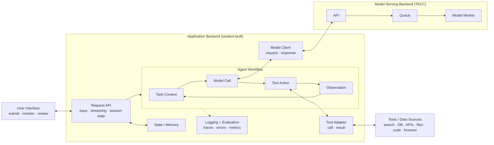

# CSIT6000V Course Project: Building an End-to-End Agent System

Course project for **CSIT6000V Advanced AI Computing and Systems** (HKUST CSE).
The goal is to build an end-to-end agent system on **TACC**. A user submits a task, an agent backend
works on it with a served model and external tools, and the user sees a verifiable result.

The full specification is in [`course_project.pdf`](course_project.pdf).

> **Status:** Team formed. Topic selected: **FlagPilot**, a replay-verified CTF agent. Project development is in progress.

---

## Team

Teams have 3–5 students.

| Name | GitHub | Role |
|------|--------|------|
| TBD  | TBD    | TBD  |

## Topic

**FlagPilot: a replay-verified CTF agent.** A user selects or uploads an offline CTF challenge.
The agent uses a served model and tools to solve it, then submits a flag and a standalone `solve.py`.
The verifier checks the answer and reruns the script in a fresh directory containing the challenge
attachments. A correct answer with a successful replay is recorded as `verified`.

The agent workflow, tool adapters, replay verifier, Web interface, and evaluation tooling are implemented.
Recent development added the Track H entry point, cost and latency metrics, dev/test split controls,
and E3 experiment scripts. See [`flagpilot/README.md`](flagpilot/README.md) for usage and
[`flagpilot/docs/STATUS.md`](flagpilot/docs/STATUS.md) for implementation progress.

Completed runs now generate English solution writeups with Web downloads. Optional encrypted
storage protects saved run records and artifacts; see
[`Writeups and encrypted storage`](flagpilot/docs/WRITEUPS_AND_STORAGE.md).

---

## Required System Architecture



**Required execution path:** Task → User Interface → Application Backend (agent workflow, model API, tools/data) → Visible Result (answer, artifact, or completed action).
Logs and traces feed into test cases and results.

### Components

- **User Interface**: task input, visible progress while the agent runs, and review of the final result.
- **Request API**: handles input, response streaming, and session state.
- **Agent Workflow**: the loop of task context → model call → tool action → observation.
- **State / Memory**: persists session and agent state across steps.
- **Model Client**: talks to the model-serving backend (endpoint → queue → model worker) on TACC.
- **Tool Adapter**: integrates **at least one** relevant capability, such as search, a database, external APIs, files, code execution, or a browser.
- **Logging + Evaluation**: records traces, errors, and metrics.

---

## Requirements

1. **Select a task or scenario.** Pick one concrete use case, such as coding, research, tutoring, or data analysis.
2. **Build the frontend.** Provide an interface for task input, visible progress, and review of the final result.
3. **Build the backend.** Implement the agent workflow, the model API, and tool/data integration.
4. **Evaluation.** Test representative cases, report metrics, and analyze **at least one failure**.
5. **Demo & Final Presentation.** Prepare a tested demo and present the task, system, evaluation, and limitations. Cover setup, configuration, and known limitations.

### Recommended Exploration Directions

| Direction | Goal | Metric |
|-----------|------|--------|
| **01 Task Learning & Adaptation** | Improve performance for a specific task, domain, or user group | Task-evaluation metric that quantifies improvement over a baseline |
| **02 System Efficiency** | Reduce latency or resource use without unacceptable loss of task quality | System metric that quantifies gains over a baseline without degrading task quality |

---

## Milestones

| # | Milestone | Due | Status |
|---|-----------|-----|--------|
| 1 | Team formation (3–5 students) | — | ✅ |
| 2 | Topic selection + **two-page proposal** (motivation, proposed system, evaluation plan) | **Oct 29** | Topic selected |
| 3 | Project development: implement, evaluate, and refine scope based on feedback | — | In progress |
| 4 | Final presentation + short demo + final code repository | TBD | ⬜ |

## Final Deliverables

- [x] Code repository (this repo)
- [ ] Final report
- [ ] Demo
- [ ] Final presentation

---

## Setup

The application uses Python **3.11+** and the standard library. Configure an external challenge dataset,
then launch the Web interface from the `flagpilot/` directory:

```bash
cd flagpilot
export FLAGPILOT_TASKS=/path/to/ctf-tasks/no-solutions
python3 -m flagpilot web --model mock
```

Open <http://127.0.0.1:8080> in a browser. The mock model runs the application flow without a model service.
For dataset preparation and model configuration, see [`flagpilot/README.md`](flagpilot/README.md).
TACC setup is documented in [`flagpilot/docs/TACC.md`](flagpilot/docs/TACC.md).
