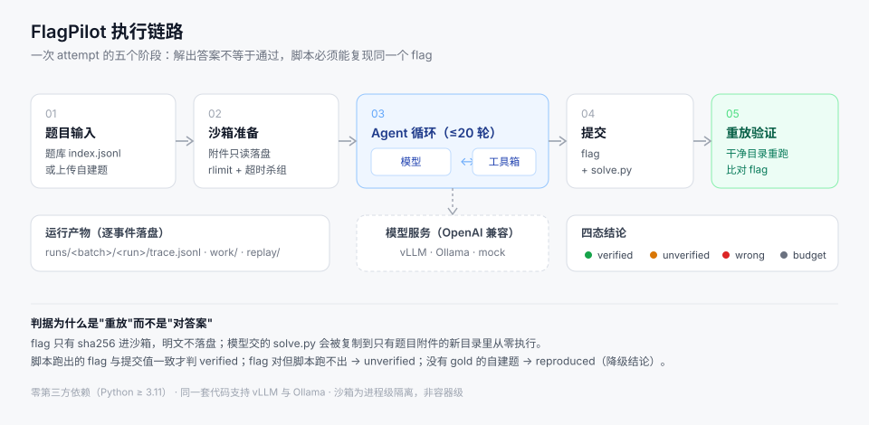

# 设计说明

面向要改代码或写报告的人。结论先行：**这个系统的核心不是"让模型解题"，而是"让解题结果可验证、可归因、可复现"**。
所有设计取舍都服务于这一条。



---

## 1. 约束

| 约束 | 来源 | 结果 |
|---|---|---|
| 零第三方依赖 | 要在 TACC 的 CPU 作业与受限环境里稳定跑 | 全标准库，`pip install` 不需要 |
| 可复现 | 同一题、同 seed、同配置要能重跑出同样结论 | 温度固定、截断确定、trace 全量落盘 |
| 可审计 | 报告里的每个数字都要能追到原始事件 | `trace.jsonl` 是唯一事实源 |
| 模型可换 | 本地 Ollama、集群 vLLM、外部 API | 统一 OpenAI 兼容客户端，只换 `base_url` |

---

## 2. 模块职责

```
                        ┌──────────────┐
   CLI / Web  ─────────▶│  runner.py   │  批跑、分片、断点续跑
                        └──────┬───────┘
                               ▼
                        ┌──────────────┐
                        │  agent.py    │  ReAct 循环、预算、循环守卫
                        └──┬────┬───┬──┘
             ┌─────────────┘    │   └──────────────┐
             ▼                  ▼                  ▼
      ┌────────────┐    ┌────────────┐    ┌──────────────┐
      │ client.py  │    │  tools.py  │    │  verify.py   │
      │ 模型流式调用│    │ 动作 → 执行 │    │ 四态判据+重放 │
      └────────────┘    └─────┬──────┘    └──────┬───────┘
                              ▼                  ▼
                        ┌────────────┐    ┌────────────┐
                        │ sandbox.py │    │  trace.py  │
                        │ 进程级隔离  │    │ 事件落盘    │
                        └────────────┘    └────────────┘
```

| 模块 | 一句话职责 | 关键点 |
|---|---|---|
| `config.py` | 预算、消融档位、模型端点 | `make_model_spec()` 是唯一构造入口 |
| `tasks.py` | 读索引、筛题、附件落盘 | `Task.brief` 绝不拼 gold |
| `sandbox.py` | 起子进程、限制资源、杀进程组 | 只读附件 + rlimit + `start_new_session` |
| `tools.py` | 解析动作、执行、裁剪观察 | 白名单路径守卫 |
| `agent.py` | 循环、预算、守卫、收尾 | 每轮只允许一个 JSON 动作 |
| `client.py` | OpenAI 兼容流式客户端 | 处理 usage、`chat_template_kwargs` 降级、`/metrics` |
| `verify.py` | 判据与重放 | 三道关：哈希 → 字面量 → 干净重跑 |
| `tagger.py` | 失败归因 | 12 类失败标签 + 证据 |
| `metrics.py` | 指标与报告 | Wilson 区间、Markdown、批次对比 |
| `context.py` | 上下文压缩 | 中段折成摘要，不调模型 |
| `memory.py` | 跨 run 记忆 | 只存结论，不存 flag |
| `chat.py` | 答疑会话 | 命令真执行，但不参与评分 |
| `custom.py` | 上传自建题 | zip 真实字节上限、路径校验 |
| `runner.py` | 批跑编排 | 分片、续跑、并发 |
| `app/server.py` | 零依赖 HTTP + SSE | 事件历史支持断线重放 |

---

## 3. 一次 attempt 的时序

```
load task ──▶ stage assets（只读）──▶ 组装 system+user prompt
                                          │
                    ┌─────────────────────┘
                    ▼
        ┌───▶ 调模型（流式，取 usage）
        │         │
        │         ▼
        │     parse_action ──失败──▶ 回灌纠正提示（最多 2 次）
        │         │
        │         ▼
        │     toolbox.execute（沙箱内，带超时）
        │         │
        │         ▼
        │     truncate(observation) ──▶ 追加到 messages
        │         │
        └─────────┘  （直到 submit / 预算耗尽 / 轮次上限）
                    │
                    ▼
        verify.evaluate() ──▶ 四态结论 ──▶ trace.summary
```

预算四道，任一触发即停：`max_turns` / `max_prompt_tokens` / `max_completion_tokens` / `max_wall_s`。

---

## 4. 六个关键取舍

### 4.1 为什么判据是"重放"而不是"对答案"

LLM 在 CTF 上很容易"报对 flag"：训练数据里见过、或者从题面猜中。
只比字符串，`verified` 率会混入大量记忆命中，指标就失去意义。

所以要求模型同时交 `solve.py`，验证分三道：

1. **哈希比对**：`sha256(flag)` 与题库里的 `gold_sha256` 比。不等直接 `wrong`。
2. **字面量扫描**：脚本里若出现 flag 明文（含 hex / base64 / 大小写变体），判 `literal_flag`，降级为 `unverified`。
3. **干净重跑**：把 `solve.py` 复制到只有题目附件的新目录，`cwd` 进去执行；
   输出里必须出现同一个 flag，才判 `verified`。

第三道是核心：它不能证明"思路正确"，但能排除"答案写死在脚本里"和"依赖上一轮残留文件"。

**豁免**：有些题目的输入本身就是 flag 的密文形态（ROT13 题的 `cvpGS{...}`），
字面量扫描会误判。`material_text()` 把附件与题面拼起来做同样的变体匹配，
命中则跳过该条 literal 判定——否则正确答案会被自己的判据判死。

### 4.2 为什么零第三方依赖

不是偏好，是部署约束：TACC 计算节点不能自由 `pip install`，课程环境不一定有网络。
全标准库意味着"`python3 -m flagpilot` 能跑就行"，没有虚拟环境、没有版本冲突。

代价是要自己写 HTTP 客户端、SSE、JSON 解析容错、指标统计。这些代码量不大，但每个坑都得自己踩。

### 4.3 为什么用 JSON 动作而不是 function calling / MCP

- **可重放**：JSON 动作是纯数据，落进 trace 就能原样重放；function calling 的调用栈在运行时里，不好审计。
- **零依赖**：Ollama 与 vLLM 对 tools 参数的支持程度不一致，JSON 动作对两者都成立。
- **可预算**：动作解析失败算一次"无效动作"，能计数、能归因；原生 tool call 的失败形态更分散。

代价：模型可能输出不合协议的文本，需要容错解析（剥 `<think>`、从文本里找第一个 JSON 对象）。

### 4.4 消融为什么是加法阶梯

`B0 → B1 → B2 → B3`，每档只比前一档多一个变量：

| 档 | 新增 | 目的 |
|---|---|---|
| B0 | — | 裸基线：不截断、无结构化工具、最小 prompt |
| B1 | 追加时截断 | 观察超长时保留头尾，前缀字节稳定才可能命中 prefix cache |
| B2 | 结构化工具箱 | 多出 `file` / `strings` / `decode`，不用每题都拿 shell 硬拼 |
| B3 | 完整规则 | 补上解题规范与提交要求（当前默认） |

如果一档改两个变量，拿到 +8pp 也说不清是哪个带来的。
档位注册表**写死在代码里**而不是读配置文件：档位一旦能被随手改，报告里的 "B2" 就不再是可复现的同一件事。

### 4.5 上下文为什么分三层

| 层 | 机制 | 触发 | 代价 |
|---|---|---|---|
| 追加时截断 | 单条观察保留头尾、中间折叠 | B1 起默认 | 可能丢掉中段线索 |
| 上下文压缩 | 中段折成「第几步 → 什么动作 → 退出码/首行」 | 总字符 > 48000 | 改写前缀会让 cache 失效 |
| 跨 run 记忆 | 同题历史结论注入 prompt | web 默认开，批跑默认关 | 可能把上一轮的坏习惯带进来 |

压缩**不调模型**：多一次调用就多一个失败点，也让同 seed 不可复现。
摘要只需要"做了什么、结果如何"，正则足够。

记忆**不存 flag、不存 solve.py**，只存 verdict / reason / 轮次 / 耗时 / 模型 / 档位。
一旦存了明文，`verified` 就退化成"查表命中"，判据自己先烂。

批跑默认关记忆，是因为 B0 的记录一旦进 B1 的 prompt，四档就不再"只差一个变量"。

### 4.6 沙箱为什么只做到进程级

纯标准库能做的极限：`subprocess` + `start_new_session` + `resource.setrlimit` + 只读 `chmod` + `cwd` 隔离 + 环境变量白名单。

它防的是**误操作**（写坏附件、跑飞、死循环、写满磁盘），不防**恶意**：

- 同 uid，`chmod +w challenge/` 就能改回来；
- 没有 `chroot` / `seccomp` / `cgroup`，`shell` 能读权限内任意路径；
- 网络是 `proxy-only`，裸 socket 仍可出网（实测可连 `1.1.1.1:80`）。

`probe_capabilities()` 会探测实际能力并写进 trace，`doctor` 也会打印。
**报告里只能按探测结果写，不能按预期写。**

---

## 5. 判据实现细节

```python
# verify.evaluate() 的判定顺序
1. flag 为空                     → wrong / no_flag
2. sha256(flag) != gold          → wrong / mismatch
3. 无 solve.py                   → unverified / no_script
4. 脚本含 flag 字面量（未豁免）   → unverified / literal_flag
5. 干净目录重跑失败              → unverified / script_error | timeout
6. 重跑输出不含同一 flag          → unverified / not_reproduced
7. 全部通过                       → verified / match
```

没有 `gold_sha256` 的自建题：跳过 2，其余照做，通过则判 `reproduced`。

脚本判定失败时**保留现场**（`replay/` 目录），报告里的失败分析直接引用。

---

## 6. 指标口径

| 指标 | 定义 | 为什么这样定义 |
|---|---|---|
| `verified / raw` | 四态里 verified 的占比 | raw 是"报对了"，verified 是"能复现"，两者差值就是卖点 |
| Wilson 区间 | 二项比例的 95% 置信下界 | 20 题样本下，点估计会严重高估；区间才是能写进报告的数 |
| 轮次 / 输出 token | 模型调用次数 / `completion_tokens` | 排除 prompt，避免"上下文长"被误读成"模型啰嗦" |
| 端到端 `e2e_s` | 收到请求 → 发出结论 | 与秒表同口径，含沙箱准备与落盘 |
| agent 循环 `wall_s` | 第一次调模型 → 最后一步 | 用于分析"时间花在模型还是工具" |
| model / tool 耗时 | 每轮 `latency_ms` / `duration_ms` 求和 | 相加 ≈ wall_s，差值是解析与拼 prompt |
| TTFT p50 | 每轮首 token 时间的中位数 | 反映 prefill 压力，比均值抗长尾 |
| prefix cache | vLLM `/metrics` 的 `gpu_prefix_cache_hit_rate` | 只有配了 `--metrics-url` 才有；Ollama 显示"未采"而不是 0 |
| GPU 秒 | **未采集** | 需要外部 `nvidia-smi` 采样或 slurm acct，当前没有 |

---

## 7. 失败归因

`tagger.py` 从 trace 事件里推断**主因**，12 类失败标签：

```
model_error        模型调用失败（超时 / 4xx / 5xx）
thinking_overflow  空回复：思维链把预算吃满（Qwen3 未关 thinking 的典型症状）
sandbox_timeout    工具或重放超时
tool_missing       环境缺工具（tshark / java / gdb）
tool_denied        权限被拒
network_blocked    误试联网
protocol           不守 JSON 协议
hardcoded          脚本硬编码答案
not_reproducible   答案对但不可复现
wrong_flag         答案错误
no_submit          轮次耗尽未提交
budget             预算耗尽（其他）
```

归因只用于**分析**，不写回 `runs.jsonl`：重算规则可以变，原始结论不能变。

---

## 8. 想继续做的话

按性价比排序：

1. **跑数据**：20 题 × 3 seeds × 四档，这是报告的地基，代码已经够用。
2. **TACC 上跑通一次 vLLM**：拿到真实的 `cache_hit_rate` 与吞吐，替换文档里的估值。
3. **writeup 生成**：`verified` 之后多一次调用，产出解题报告，直接补上 proposal 的第 6 步。
4. **容器化沙箱**：Apptainer + `--network none`，把"进程级"升级成"真隔离"。
5. **E4 升级策略**：stall 检测 + 升级预算，proposal 允许最先砍，最后做。
