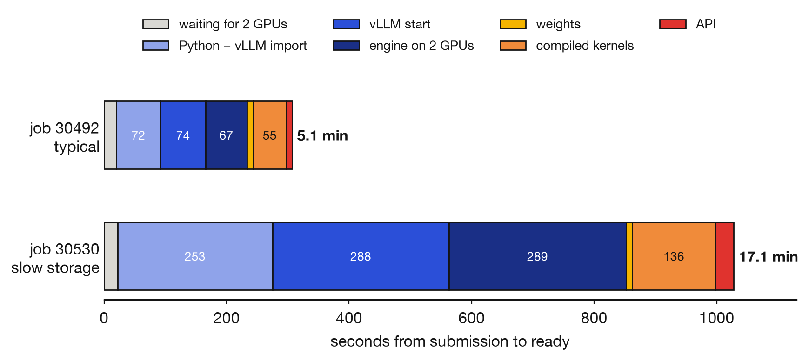

# Running Qwen on TACC from the web page: measurements and reliability notes

The README's §4D says what the page does with TACC; this file keeps the measurements, the failures found on the real
cluster (2026-11-20 to 2026-11-22) and what was changed for each. Everything goes through the course SDK (`tcloud`
submit, ps, cat, cancel, download): no login on the platform's servers and no SSH forwarding.

## How the page uses the cluster

- **Connecting** submits one serving job (`deploy/tcloud/submit.sh serve`: the course's vLLM serving script for
  `qwen3.8-27b` on two RTX 3090s) and keeps it for the partition's hour, counted from when the job starts running. It
  is cancelled three minutes before the limit, or when the chip is clicked again. Restarting the web server reconnects
  to a serving job that is still running; `./start.sh --stop` ends the session, `--restart` keeps it.
- **Run on TACC** submits a small client job with just that challenge. The job prints each trace event into its log;
  the page reads it with `tcloud cat` every 4 s, then downloads the finished run and mounts it as a replay.
- **Ask** sends each message as one small job (`fp chat-once`) that returns its reply the same way. Threads stay on the
  laptop in `runs/chat/`; the job receives the earlier exchanges the conversation's context plan selected.
- A reply is a Slurm job, so most of its time is the SDK upload and scheduling, not the model. The SDK uploads files one
  by one, so client jobs ship everything except `tuxiv.conf`, `job.sh` and `run.env` as one `payload.tgz`: an Ask reply
  went from 43.7 s to 26.6 s, one with a challenge attached from about 79 s to 56 s.
- While another job of the account is running, a new request waits ("on hold") instead of failing, and the page shows
  Slurm's reason for any queue (the account's two-job limit, or no free GPUs).
- A run needs about 7 minutes of the session and a reply about 3. With less left, the page asks whether to start a new
  session and run (or send) as soon as it is ready, instead of submitting a job that could not finish.
- **Finish** ends a run on the page at once and cancels its job in the background; the client slot is freed only once
  Slurm has dropped the job, so the next job never shares the working directory with it. Recalling an Ask message
  cancels its job too.

Measured on 2026-11-20 (serving job 30111): ready in 5 minutes, one Ask reply in 31 s, and `general-004` (B3) from click
to `verified` in 64 s.

## Start-up

Clicking the **Qwen on TACC** chip opens the session panel. While the serving job starts it lists each step (waiting
for two GPUs, with Slurm's reason and the number of jobs ahead; GPUs assigned; vLLM; engine; weights, with percentage;
compiled kernels; warm-up; API), the time each took, an estimate of the time left and the job's live log; while it is
open the server reads the log every 4 s instead of every 15 s. The estimate keeps the steps still to come and says when
a step is slower than usual (with slow storage it used to say "about 5 s left" with four steps to go).

Job 30425 (2026-11-21): 2.5 minutes waiting for GPUs, then 5.2 minutes from GPUs assigned to ready, of which about 1.7
minutes load Python and vLLM from shared storage, 2.2 minutes start the engine and its two workers, and 45 s load the
compiled kernels. Job 30530 needed 17 minutes: 4 to load Python and vLLM, nearly 10 more to start vLLM and its engine.
Those steps run inside the course's serving script, whose settings the course fixes.

## Fixes of 2026-11-21

- **Healthy servers were cancelled.** Every vLLM start prints a harmless warning that contains a Python traceback (a
  `deep_gemm` import) about 12 s before the server is ready; the page and the pipeline read any traceback as a crash and
  cancelled healthy servers (jobs 30270, 30272, 30281, 30442, 30446). A serving job now counts as failed only when it
  has really ended: Slurm's end markers, the supervisor's stop line, or gone from `tcloud ps` twice in a row.
- **Submissions retry** when TACC's login gateway drops the SSH handshake (six tries over about two minutes, each shown
  on the page), and an SDK error is never read as "no jobs" or as a log.
- **Job scope.** A challenge the job would not select (an upload, or one of the ten `extra-gs` challenges) is staged
  with the job's scope, and a local check runs the job's own selection before anything is submitted. A job that ends
  without a result says why, for example that too little of the session was left.

## Checked on the cluster

`scripts/live_tacc_check.py` drives the page's own API against the real cluster: 20 checks covering the start-up
panel, a solve, an uploaded and an `extra-gs` challenge, a hint, Finish while the job runs, Ask in Chinese and
English, recall, and ending the session. It starts a Qwen session (two GPUs for about 25 minutes); run it only when no
other job of the account is on TACC. The logs of the three passes are in `flagpilot/results/live/`.

The first two passes (serving jobs 30492 and 30507) found five problems, all fixed:

- An SDK call through TACC's gateway sometimes hangs for about 140 s before failing. With a 120 s limit, four of five
  runs showed "queued" while their job ran, then every event at once. Reads now give up after 25 s and reconnect on the
  next poll.
- A recalled question went on retrying a submission the gateway kept dropping, even after the session had been
  stopped, uploading into the working directory the next job uses. A recall, Finish or stopped session now stops the
  retries, and a job that the try in flight still submits is cancelled at once.
- A question recalled while its job was on TACC replied anyway (job 30516): the recall was only noticed between reads,
  and each cancel waited for three Slurm listings. Finish and recall now cancel the moment they are pressed, and the
  cancel is resent every 8 s until Slurm drops the job.
- A session stopped while starting and started again could be taken over by the old start-up's late job, which was
  then never cancelled (two GPUs for an hour). Each session now has a generation.
- With slow shared storage the start-up panel said "about 5 s left" with four steps to go (see *Start-up*).

The third pass (commit `a7db55b`, serving job 30530, a 17-minute start-up) passed 19 of 20 checks. Finish was pressed
while the job ran, after three of the model's replies had reached the page, and Slurm dropped the job 8 s later; a
recalled question's job was cancelled before it replied; a run's events arrived over 8 s, as they happened. The one
failure was an upload whose job started without its payload (job 30538): the SDK had submitted it although the payload
never arrived. `submit.sh` now records the payload's checksum and `job.sh` checks it first; a job whose payload did not
arrive says so (`[fp] payload missing`, exit 3), and the page sends it again once. An upload the gateway cuts off in the
middle (`Failed to upload env repository`) is retried like a dropped handshake, since nothing has been submitted.

## The shared home volume

`/mnt/home` is one 7.3 TB volume for every user of the cluster. On 2026-11-21 it filled up six minutes into the
pipeline of `v7`'s B1 and B2 (`No space left on device` at attempt 14 of B1; 93 MB were left), and after that no job
could be submitted: the SDK could not upload its working directory. Our share was what batches left behind: every
attempt's working directory and three copies of its challenge (clean replay, empty-material and changed-text checks),
about 150 MB per tier. Client jobs now keep only each attempt's records after a batch's report, and
`deploy/tcloud/submit.sh cleanup` deletes the batches named in `FP_DROP` and prunes the rest; it uploads three small
files, so it can be submitted when the volume is full, and `FP_PRUNE_LOGS=1` also deletes job logs older than two days.
That run (job 30491) freed 1.4 GB and left our directory at about 340 MB, most of it the course model's compile cache,
and B1 and B2 ran again from scratch (pipeline 3, serving job 30502, client job 30505). The logs of all three pipelines
are in `flagpilot/results/tacc/v7`; the aborted B1 ledger is not counted anywhere.

Whether a job finds room still depends on everyone else: when `No space left on device` appears although your own
directory is small, the volume is full and only the cluster's administrators can free it. A full volume is named on the
page and not retried. Deleting cannot be undone: download what you need first (`tcloud download -r
flagpilot-runs/<batch> runs/tacc/`).

## The login gateway

Every SDK call opens an SSH session through TACC's login gateway. In a five-minute measurement on 2026-11-21, 1 of 38
`tcloud cat` calls hung for 142 s before failing ("Failed to create remote session"); the others took 0.8 s. At busy
times submissions fail outright. The page gives up a read after 25 s and reconnects on the next poll, retries a
submission for about two minutes, and resends a cancel every 8 s until Slurm drops the job. On a bad day its view of a
job can therefore lag by up to half a minute, and a Finish or recall can take a minute to reach Slurm (the page itself
ends the run at once). `[tacc] tcloud …: took N s` lines in the server log show slow calls.

## One FlagPilot per TACC account at a time

Every client job of an account unpacks into the same working directory on TACC (`WORKDIR/flagpilot-client`). A server
lets only one of its jobs run at a time, but two independent submitters do not know about each other: on 2026-11-21 a
test job submitted from the command line (job 30558) while the page's run (job 30559) was being uploaded unpacked the
page's files and deleted its payload, and the page's job stopped (`[fp] payload missing`, exit 3). Use one server per
account, and do not run `deploy/tcloud/pipeline.sh` while its Qwen session is in use. Giving every job its own working
directory would remove the limit; it changes the SDK's job and log names and needs the job to delete its directory
afterwards on a volume that is nearly full, so it is not done yet.
